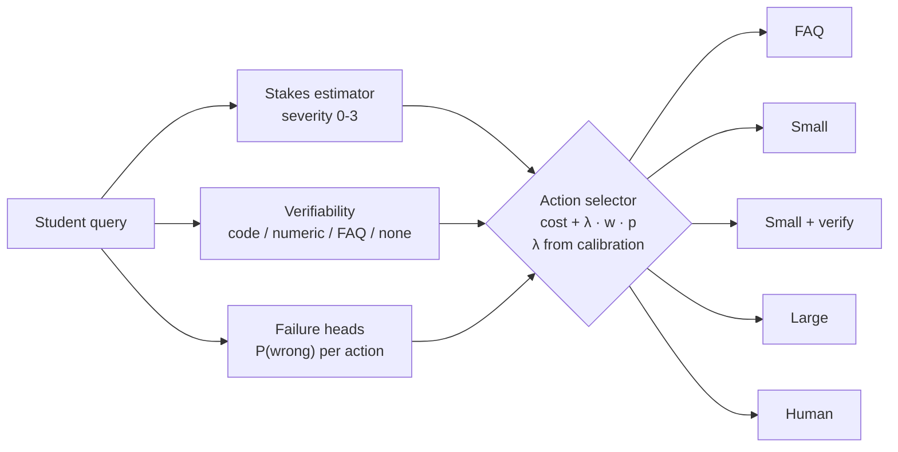

# RiskAwareRouter: Risk-Aware LLM Routing

[](https://github.com/Zhussain13/RiskAwareRouting/actions/workflows/ci.yml)


**Not all wrong answers cost the same.** A wrong synonym is harmless; a wrong exam date or
health answer is not. Cost-aware routers ask *"can the cheap model get this right?"*.
A risk-aware router also asks *"how bad is it if it doesn't?"*

Risk here = probability that the chosen action is wrong × the severity of that error (0-3).
For every question, RiskAwareRouter picks the cheapest action whose risk fits the budget:

| Action | Used when |
|---|---|
| **FAQ answer** | A stored answer matches with high confidence |
| **Small model** | Low stakes, likely correct |
| **Small model + verifier** | The answer can be checked: C code via gcc, arithmetic, FAQ facts |
| **Large model** | High stakes or likely wrong |
| **Flag for a human** | Too risky for any model |

A calibration step sets the routing threshold so that the **expected severity-weighted
error stays below a budget α**. This is a distribution-free guarantee, not a hand-tuned
cutoff.

This project extends [SmartModelRouter](https://github.com/Zhussain13/SmartModelRouter)
(FAQ → small → large, routing on difficulty only). It keeps that project's models, data
and routers as baselines.

> **Status:** complete pipeline, run end to end on a free Colab T4 (about 40 minutes of GPU time).
> Final results: [`results/final_run_2026-11-21.md`](results/final_run_2026-11-21.md).
> Headline: both calibration guarantees hold (CRC mean severity-weighted error 0.0450 against a
> budget of 0.05; LTT under budget in 98% of splits). Severity-3 errors fall by half or more versus
> SmartModelRouter, and verification cuts cost by 12.6%. Predicting severity itself gave
> no measurable gain at matched cost, which is reported as a negative result. Demo-mode numbers are simulated.

---

## How it works



For a query *x* and action *a*:

```
score(x, a) = expected_cost(a) + λ · w(severity_hat(x)) · P_hat(a is wrong | x)
```

The selector picks the lowest score among available actions. As λ grows, the predicted
risk of the chosen action can only fall, which keeps calibration well behaved.

**Calibration.** On held-out calibration queries, the loss of a query is
`w(true severity) × [answer wrong]`, which lies in [0, 1]. Two calibration methods are available:

| Method | Guarantee | Notes |
|---|---|---|
| `crc` (default) | E[severity-weighted error] ≤ α | Conformal risk control on monotonised losses (a valid upper bound) |
| `ltt` | P(risk ≤ α) ≥ 1 − δ | Learn-then-Test with Hoeffding-Bentkus p-values; needs no monotonicity |

Severity weights default to `w = (0, 0.1, 0.4, 1.0)` for levels 0-3, and are swept in the ablations.

**Verifiers** are external checks, not self-grading:
- **code**: gcc compiles and runs the program in the question; the small model's predicted
  output must match.
- **numeric**: the small model also writes a Python expression; it is evaluated safely and
  must agree with the stated answer.
- **faq**: an NLI model checks that the retrieved FAQ entry entails the answer.

If a verifier fails, the query falls back to the large model.

---

## StakesQA (the dataset)

| Slice | Source | Now | Target | Answer type | Graded by |
|---|---|---|---|---|---|
| CS concepts | SmartModelRouter `queries.csv` | 327 | 327 | open | LLM judge |
| C code output | generated (16 misconception families), gold from gcc | 250 | 250 | program output | script |
| College logistics | paraphrases of `faq.csv` + "not in the FAQ" near-misses | 38 | 250 | open | LLM judge |
| Numeric reasoning | GSM8K test sample | 200 | 200 | number | script |
| Misconceptions | TruthfulQA MC1 (options shuffled) | 150 | 150 | option letter | script |
| Health | MedMCQA validation sample | 150 | 150 | option letter | script |
| Kanglish (shift test) | SmartModelRouter Kanglish set | 10 | 110 | open | LLM judge |

To do before the paper run:
- Extend `data/slices/logistics.csv` with real CMRIT and VTU circulars, and add their answers to `data/faq.csv`.
- Add about 100 Kanglish queries to `data/slices/kanglish.csv`.
- Optionally add student-phrased health questions.

**Severity labels** follow `data/rubric/severity_rubric.md`. Labelling runs in three steps:
`labels.py export` → two annotators → `labels.py merge` (weighted Cohen's κ) →
`labels.py finalise` → `data/severity_human.csv`. Until that file exists, the pipeline uses LLM
pre-labels and says so in every output.

---

## Quick start: demo mode (no GPU, about 30 seconds)

```bash
git clone https://github.com/Zhussain13/RiskAwareRouting.git
cd RiskAwareRouting
pip install -r requirements.txt
python run_pipeline.py --demo
```

Results are written to `outputs/demo/results/`: `summary.md`, `cost_vs_risk.png`,
`guarantee.json`, plus per-split CSVs.

## Real run: free Colab T4, under 3 hours

Open `notebooks/RiskAwareRouter_Colab.ipynb` in Colab and choose a **T4 GPU**. Every stage
checkpoints to Google Drive and skips itself once done.

| Stage | Command | Estimated time on a T4 |
|---|---|---|
| 0 Dataset | `python build_dataset.py` | ~3 min |
| 1 Small answers | `python generate.py --role small` | ~10 min |
| 2 Large answers | `python generate.py --role large` | ~30-45 min |
| 3 Grade + severity pre-labels | `python grade.py` | ~15 min |
| 4 Verifiers | `python verify.py` | ~5-10 min |
| 5 Evaluate (CPU) | `python evaluate.py` | ~5-15 min |

What keeps it under 3 hours:
- Batched generation with vLLM.
- Short answer caps for each answer type.
- Script grading for everything with a gold answer (about two thirds of queries), so the LLM judge only sees open answers.
- Every later experiment replays cached answers on CPU.

Run `generate.py --limit 50` first to time your own session.

**Models** (all free): Qwen2.5-3B-Instruct (small) · Qwen2.5-14B-Instruct-AWQ (large) ·
Llama-3.1-8B-Instruct AWQ (judge; a different family, so no model grades itself) ·
all-MiniLM-L6-v2 (router features) · DeBERTa-v3 MNLI (FAQ verifier). All of them are set in `config.py`.

---

## What is compared

| Group | Methods |
|---|---|
| Ours | `ours_crc`, `ours_ltt`, `ours_no_human` (no flag action: reports whether α is reachable without people) |
| References | always small, always large, oracle |
| SmartModelRouter | rule, learned and cascade routers with their 95%-of-large-accuracy thresholds; learned router + keyword risk floor |
| Same budget as ours | stakes-blind risk router at matched cost; SmartModelRouter learned at matched cost |
| Ablations | no verify, no FAQ, stakes-blind, no calibration, LLM or rule severity labels instead of human ones, 30% of severity-3 queries mis-estimated, flat or steep weights |
| Shift | Kanglish queries never seen in training or calibration |

**Metrics:**
- cost per 1,000 queries (paid list prices)
- accuracy
- **SWER** (severity-weighted error)
- **HSER** (error rate on severity-3 queries)
- large-model call share, flag rate, verify share
- p50/p95 latency
- the guarantee check over 100 random splits

## Project structure

```
build_dataset.py   stage 0  assemble StakesQA            riskroute/dataset.py, cprograms.py
generate.py        stage 1-2 batched answers (vLLM)      riskroute/backend.py, parsing.py
grade.py           stage 3  script grading + LLM judge   riskroute/severity.py
verify.py          stage 4  gcc / Python / NLI checks    riskroute/verifiers.py
evaluate.py        stage 5  splits, methods, plots       riskroute/experiment.py, router.py,
                                                          calibration.py, metrics.py, table.py
labels.py          human severity labelling + kappa
run_pipeline.py    all stages, skip-if-done, timings
riskroute/simulator.py   demo-mode stand-in for every model
```

## Limitations

- **The code verifier is strong on this slice by design.** The generated programs are
  complete and runnable. Real student code often is not, so treat that slice as an upper
  bound for verification.
- **Open answers are graded by an LLM judge.** Its accuracy is measured on a 10%
  hand-audited sample (`judge_audit.csv`) and should be reported.
- **Costs are list-price proxies**, because every model here runs for free. The cost of a
  human answer is a configurable multiple of the large model's cost; vary it.
- **The guarantees assume calibration and test queries come from the same distribution.**
  The Kanglish set measures what happens when they do not.

## License

MIT, see [LICENSE](LICENSE).
